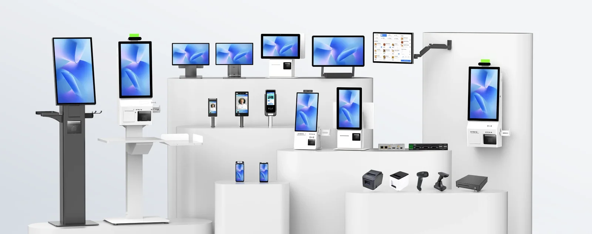
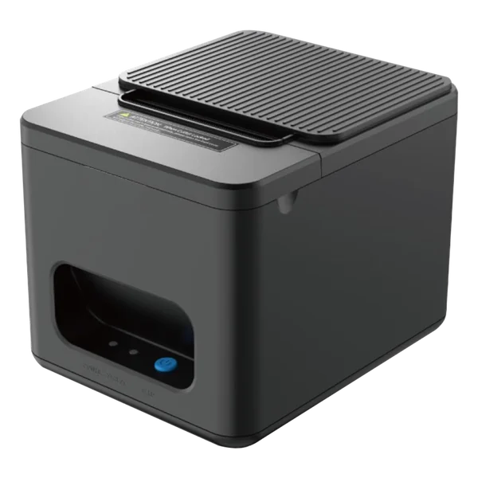
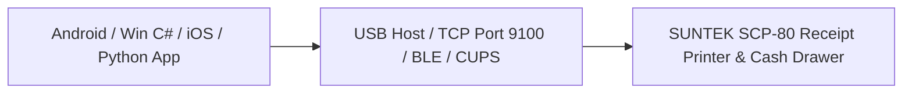

<div align="center">
  <a href="https://www.suntekai.com">
    <picture>
      <source media="(prefers-color-scheme: dark)" srcset="./assets/logo-dark.png">
      <source media="(prefers-color-scheme: light)" srcset="./assets/logo-light.png">
      
    </picture>
  </a>

  <h1>SUNTEK SCP80 Thermal Receipt Printer SDK</h1>

  <p>
    <strong>Official Hardware SDK &amp; Developer Kit</strong> &middot; <em>Enjoy Smarter Service</em><br>
    Cross-platform ESC/POS thermal receipt printer and cash-drawer SDK for <strong>SUNTEK SCP80</strong> across Android, Windows C#, iOS, and Ubuntu Linux CUPS (<strong>SUNTEK Technology Co., Ltd.</strong>).
  </p>

  <p>
    <a href="./LICENSE"></a>
    <a href="https://github.com/SUNTEK-Official/suntek-sdk-printer-scp80/releases"></a>
    
    <a href="https://www.suntekai.com/products/thermal-receipt-printer-scp-80/"></a>
    <a href="mailto:support@suntekai.com"></a>
  </p>

  <p>
    <a href="#hardware-showcase--compatibility">Hardware</a> &nbsp;&bull;&nbsp;
    <a href="#architecture--key-capabilities">Architecture</a> &nbsp;&bull;&nbsp;
    <a href="#supported-interfaces--physical-connections">Interfaces</a> &nbsp;&bull;&nbsp;
    <a href="#5-minute-quick-start">Quick Start</a> &nbsp;&bull;&nbsp;
    <a href="#sample-apps--prebuilt-downloads">Downloads</a> &nbsp;&bull;&nbsp;
    <a href="#troubleshooting--faq">FAQ</a> &nbsp;&bull;&nbsp;
    <a href="#documentation-changelog--support">Support</a>
  </p>
  
</div>

---

## Hardware Showcase & Compatibility

<table>
  <tr>
    <td align="center" width="38%">
      <a href="https://www.suntekai.com/products/thermal-receipt-printer-scp-80/">
        
      </a>
      <br>
      <strong>SCP-80</strong><br>
      <sub>80mm Thermal Receipt Printer</sub><br>
      <a href="https://www.suntekai.com/products/thermal-receipt-printer-scp-80/">Official Product Page</a>
    </td>
    <td valign="top" width="62%">
      <ul>
        <li><strong>Supported Platforms</strong>: Android, Windows C#, iOS Objective-C, Ubuntu Linux CUPS</li>
        <li><strong>Command Sets</strong>: Standard ESC/POS &amp; label thermal commands</li>
        <li><strong>Connectivity</strong>: USB Host, Ethernet TCP Port 9100, BLE / Wi-Fi, Serial</li>
        <li><strong>Cash Drawer</strong>: Built-in RJ11/RJ12 kick pulse command support</li>
      </ul>
    </td>
  </tr>
</table>

| Product Model | Chipset / Board | OS Versions | Build Identifier | Status |
| :--- | :--- | :--- | :--- | :---: |
| **SCP80 (Android)** | USB / Ethernet / Bluetooth / Serial | Android 8 - 14 | printersdk.jar | Supported |
| **SCP80 (Windows)** | USB / LAN (Port 9100) | Windows 10 / 11 | POSDLL.dll C# | Supported |
| **SCP80 (iOS)** | BLE / Wi-Fi / LAN | iOS 13+ | PrinterSDK.framework | Supported |
| **SCP80 (Linux)** | USB Raw / CUPS | Ubuntu 20.04 / 22.04 / 24.04 | CUPS usbraw | Supported |

> [!IMPORTANT]
> Verify your device **Model** and **Build Number** under Android **Settings -> About device** before integration. Customer applications use your own Google Play or enterprise release certificate.

---

## Architecture & Key Capabilities

- **4 Operating Systems Covered**: Android (`printersdk.jar` + `libserial_port_gp.so`), Windows C# (`POSdllDemo` + `POSDLL.dll` + `libUsbContorl.dll`), iOS (`PrinterSDK.framework`), and Linux CUPS (`usbraw`).
- **Zero-Driver Raw LAN Printing**: Print directly from Python, Node.js, or Go over TCP Port 9100.
- **Pure English Command Manuals**: Complete ESC/POS and label command PDF specifications in `docs/`.



---

## Supported Interfaces & Physical Connections

| Hardware Feature | Interface Type | Device Path / Service Target | Notes |
| :--- | :--- | :--- | :--- |
| **Android SDK & Demo** | USB Host / BT / Serial / Wi-Fi | `sdk/android/printersdk.jar & android/` | Includes `printersdk.jar`, `zxingcore.jar` & 4-ABI `libserial_port_gp.so` |
| **Windows C# SDK** | P/Invoke Native DLL | `windows/POSdllDemo/POSDLL.dll & libUsbContorl.dll` | Both DLLs bundled directly beside `POSdllDemo.csproj` |
| **iOS SDK & Demo** | Objective-C Framework | `sdk/ios/PrinterSDK.framework & ios/iOS_SDKDemo/` | Ready-to-open Xcode sample with embedded `PrinterSDK.framework` |
| **Linux CUPS Raw** | CUPS `usbraw` Backend | `lp -d SUNTEK-SCP80 -o raw` | See `linux/ubuntu-cups-setup.md` |

---

## Repository Directory Layout

```text
suntek-sdk-printer-scp80/
├── assets/                 # Official SUNTEK logos, banners & SCP-80 product render
├── sdk/
│   ├── android/            # printersdk.jar & jniLibs/*/libserial_port_gp.so
│   └── ios/                # PrinterSDK.framework (Release)
├── android/                # Original Android Studio Demo project (com.gpsdk.demo)
├── windows/                # Original Windows C# POSdllDemo + POSDLL.dll & libUsbContorl.dll
├── ios/                    # Original Xcode iOS_SDKDemo project + PrinterSDK.framework
├── linux/                  # Ubuntu CUPS usbraw integration guide
├── docs/                   # Pure English Android & iOS ESC/POS / Label PDF manuals
├── README.md
├── LICENSE
├── THIRD_PARTY_NOTICES.md
└── CHANGELOG.md
```

> All installers (`.exe`), compiled sample APKs (`.apk`), and large binary packages (> 5 MB) are hosted on [**GitHub Releases**](https://github.com/SUNTEK-Official/suntek-sdk-printer-scp80/releases) with `SHA256SUMS.txt`.

---

## Prerequisites & Permissions

- **Platform Target**: `minSdk 19` / `targetSdk 30`
- **App Signing Requirement**: No platform signing key required. Standard Android USB Host permission only.
- **Required Permissions / Capabilities**: Android `android.hardware.usb.host`, Bluetooth, `INTERNET` (LAN printing).

---

## 5-Minute Quick Start

### Option A: Raw TCP Port 9100 (Zero-Dependency Python / POS)

```python
import socket

ESC_INIT = b"\x1b@"
ESC_CUT = b"\x1dV\x42\x00"
payload = ESC_INIT + b"SUNTEK SCP80 Test Receipt\n\nwww.suntekai.com\n\n" + ESC_CUT

with socket.create_connection(("192.0.2.10", 9100), timeout=5) as sock:
    sock.sendall(payload)
```

### Option B: Android Gradle Dependency

```gradle
dependencies {
    implementation files('libs/printersdk.jar')
    implementation files('libs/zxingcore.jar')
}
```

### Build & Run Sample Project

```bash
cd android && ./gradlew assembleDebug
```

---

## Sample Apps & Prebuilt Downloads

Verified prebuilt APKs, offline SDK bundles, and checksum manifests are published on [**GitHub Releases**](https://github.com/SUNTEK-Official/suntek-sdk-printer-scp80/releases). Verify downloaded archives before production deployment:

```bash
shasum -a 256 -c SHA256SUMS.txt
```

---

## Troubleshooting & FAQ

<details>
<summary><b>Which printing transports and paper widths are supported on SCP80?</b></summary>
<p>SCP80 supports 80 mm thermal paper over USB Host, Ethernet TCP Port 9100, BLE/Wi-Fi, and serial RS-232.</p>
</details>

<details>
<summary><b>Are `printersdk.jar`, `POSDLL.dll`, `libUsbContorl.dll`, and `PrinterSDK.framework` included directly in Git?</b></summary>
<p>Yes. All Android, Windows, and iOS runtime libraries are included inside `sdk/` and each OS sample directory so projects compile and run immediately.</p>
</details>

<details>
<summary><b>How do I configure raw USB receipt printing on Ubuntu?</b></summary>
<p>Follow `linux/ubuntu-cups-setup.md` to bind the CUPS `usbraw` backend and send raw ESC/POS bytes.</p>
</details>

---

## Documentation, Changelog & Support

- **Changelog**: [CHANGELOG.md](./CHANGELOG.md)
- **Developer Documentation Portal**: [suntek-docs](https://github.com/SUNTEK-Official/suntek-docs)
- **Technical Support**: [support@suntekai.com](mailto:support@suntekai.com)
- **Bug Reports**: [Open an Issue](https://github.com/SUNTEK-Official/.github/issues/new/choose)
- **Security Disclosures**: See [SECURITY.md](https://github.com/SUNTEK-Official/.github/blob/main/SECURITY.md) or email [support@suntekai.com](mailto:support@suntekai.com)

---

<div align="center">
  
  <br><br>
  <strong>SUNTEK Technology Co., Ltd.</strong> &mdash; <em>Smart Commercial Terminal Hardware Manufacturer Since 2010</em><br>
  <sub>80+ Export Countries &middot; 5,000,000+ Terminals Shipped &middot; 500+ ODM Projects &middot; ISO 9001 / ISO 14001 / ISO 27001 / CE / RoHS</sub><br>
  <sub><a href="https://www.suntekai.com">www.suntekai.com</a> &middot; Copyright &copy; 2026 SUNTEK Technology Co., Ltd. All rights reserved.</sub>
</div>
